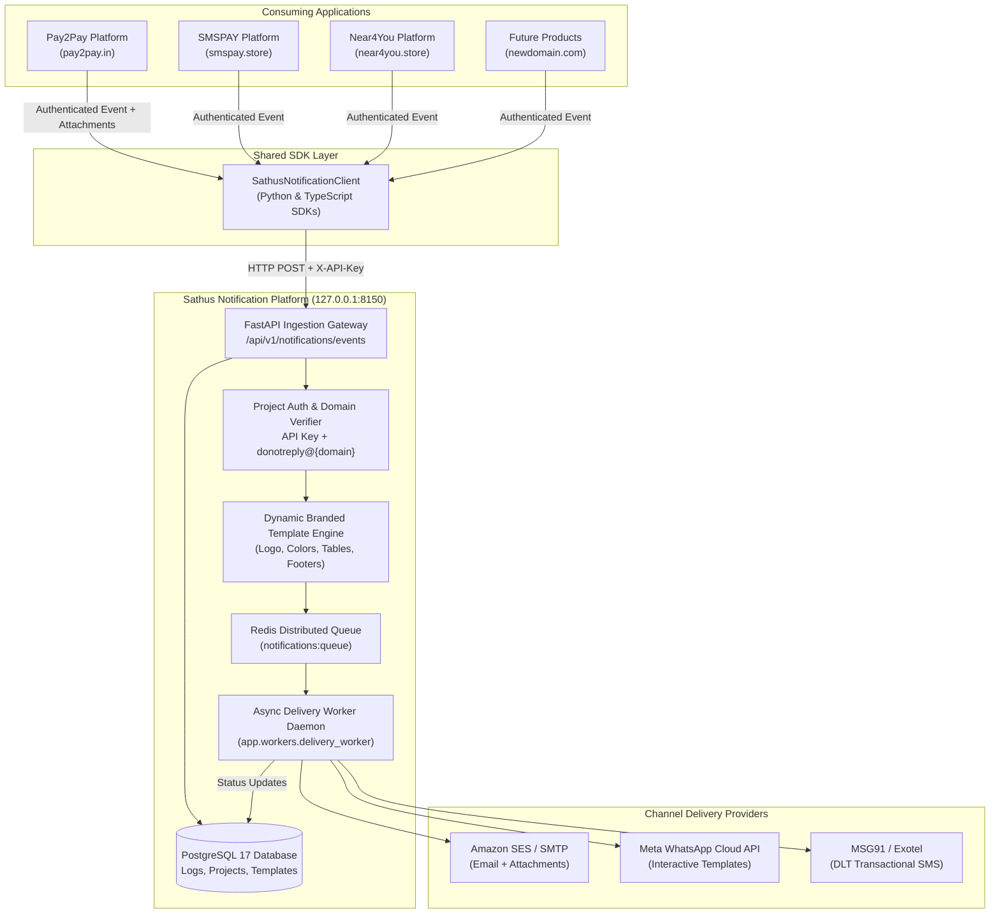

# GLOBAL NOTIFICATION INTEGRATION DESIGN
## Architecture, Dynamic Multi-Project Registry, and Event Specifications

---

### 1. Architectural Overview

The **Sathus Notification Platform** serves as the central multi-tenant notification backbone across all Sathus Technology applications (e.g., `Pay2Pay`, `SMSPAY`, `Near4You`, `OH-ID`, `Vmaila`).

The platform decouples business applications from third-party vendor APIs, sender domains, rate limiting, and queue orchestration.



---

### 2. Dynamic Multi-Project Registry

Consuming applications are dynamically registered in the `projects` table without code modifications:

```json
{
  "project_code": "PAY2PAY",
  "name": "Pay2Pay Enterprise Platform",
  "domain": "pay2pay.in",
  "is_domain_verified": true,
  "sender_name": "Pay2Pay Enterprise",
  "logo_url": "https://pay2pay.in/assets/logo.png",
  "primary_color": "#0284c7",
  "accent_color": "#38bdf8",
  "support_email": "support@pay2pay.in",
  "support_phone": "+91 1800 292 982",
  "allowed_channels": ["email", "sms", "whatsapp"],
  "rate_limit_per_minute": 1200
}
```

#### Multi-Tenant Security Rules:
1. Each application receives an isolated API key hashed with SHA-256 (`api_key_hash`).
2. The key prefix (`snk_{code}_...`) identifies the tenant at request entry.
3. Every log entry, template, and analytics record is scoped to `project_id`.
4. Tenant isolation is strictly enforced at database and API levels: no cross-project queries are permitted.

---

### 3. Dynamic Sender Identity Resolution

Sender addresses are dynamically computed using the verified domain configuration:

$$\text{Sender Email} = \text{donotreply@} + \text{project.domain.lower()}$$

#### Enforcement Pipeline:
1. **Domain Presence Check:** If `project.domain` is empty or missing, the platform raises `ProjectNotConfiguredError` (HTTP 400).
2. **Domain Verification Check:** If `project.is_domain_verified` is `false`, the platform raises `DomainNotVerifiedError` (HTTP 403).
3. **Display Name Resolution:** The display name defaults to `project.sender_name or project.name`.
4. **Header Construction:** Constructs RFC-5322 header: `"{sender_name}" <donotreply@{verified_domain}>`.
5. **No Silent Fallback:** The platform never invents or substitutes unverified sender addresses.

---

### 4. Dynamic Generic Event Engine

Instead of hardcoding notification types into business logic, applications emit structured business events via `POST /api/v1/notifications/events`.

#### Event Request Schema:
```json
{
  "event_type": "ACCOUNT_STATEMENT",
  "event_category": "FINANCIAL",
  "recipient": {
    "email": "retailer@pay2pay.in",
    "name": "Sri Krishna Retailers",
    "phone": "+919876543210"
  },
  "title": "Daily Account Statement",
  "data": {
    "statement_date": "15 November 2026",
    "opening_balance": 50000.0,
    "total_credit": 125000.0,
    "total_debit": 85000.0,
    "closing_balance": 90000.0,
    "password_hint": "First 4 PAN (CAPS) + Last 4 Mobile"
  },
  "attachments": [
    {
      "filename": "Pay2Pay_Statement_2026-11-15.pdf",
      "content_base64": "JVBERi0xLjQKJcTl8uXrp/OgCjEgMCBvYmo...",
      "content_type": "application/pdf"
    }
  ],
  "idempotency_key": "stmt_retailer@pay2pay.in_2026-11-15_ret"
}
```

---

### 5. Template Engine & Dynamic Branding

The `TemplateEngine` renders responsive HTML and plaintext messages adhering to corporate styling:
- **Header:** Branded banner colored by `project.primary_color` with application title and logo.
- **Body:** Dynamic financial breakdown tables, high-visibility OTP verification cards, or action buttons.
- **Security Reminders:** Standardized fraud warning preventing credentials disclosure.
- **Footer:** Corporate copyright notice, support email, phone numbers, and support URLs.

---

### 6. Queueing, Delivery, & Retries

1. **Ingestion & Validation:** Fast synchronous response (HTTP 202 Accepted) returning a `notification_id`.
2. **Idempotency Guard:** Redis cache check preventing duplicate submissions within a 24-hour window.
3. **Queue Distribution:** Enqueued to Redis list `notifications:queue`.
4. **Worker Dispatch:** Background consumer pulls tasks, invokes the channel provider adapter.
5. **Exponential Retries:** Failed jobs retry up to `MAX_RETRY_COUNT` (3 attempts) with backoff ($2^{\text{attempt}}\text{s}$).
6. **Dead-Letter Queue:** Permanently failing jobs are archived in `notifications:dlq` with full diagnostic error payloads.
